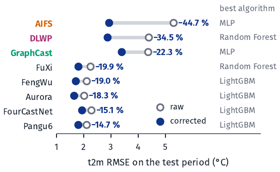
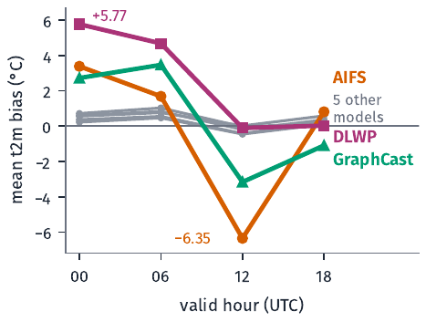
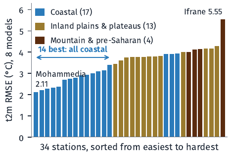

# Calibration of AI Weather Models Using Machine Learning

**Measuring and correcting the systematic errors of eight AI weather models at 34 Moroccan weather stations.**


Initiation internship at the **General Directorate of Meteorology of Morocco (DGM, Maroc Météo)**, carried out by
**Hamza Idrissi Meliani**, engineering student in Mathematics and Systems Engineering at the
**Hassania School of Public Works (EHTP)**, under the supervision of Dr. Badreddine Alaoui, Senior Data Scientist.

📄 [Full report (PDF, 65 pages)](reports/internship_report.pdf) · 🎤 [Defense slides (PDF)](reports/defense_presentation.pdf) · 📓 [Main notebook](notebooks/01_eda_and_calibration.ipynb)

---

## Contents

- [Overview](#overview)
- [Key results](#key-results)
- [Data](#data)
- [Method](#method)
- [Repository structure](#repository-structure)
- [Reproducing the analysis](#reproducing-the-analysis)
- [Limitations and next steps](#limitations-and-next-steps)
- [References](#references)
- [Citation](#citation)
- [License](#license)
- [Acknowledgements](#acknowledgements)

## Overview

Since 2022, data-driven weather models (GraphCast, Pangu-Weather, FourCastNet, AIFS, ...) produce global
forecasts in minutes instead of hours. Their published scores are computed on global grids against reanalysis,
which says little about how they behave **at a given station in Morocco**.

This project answers four questions for eight AI models:

1. How large is their error at Moroccan stations, for five weather variables?
2. What explains that error: hour of the day, forecast horizon, location, season?
3. Can a machine learning model learn the error and subtract it from the forecast?
4. By how much does the corrected forecast beat the raw one, on unseen and more recent data?

**Calibration** here means statistical post-processing: a model predicts the bias of each forecast from
information available at forecast time, and that predicted bias is removed:

```
corrected forecast = raw forecast − predicted bias        with   bias = forecast − observation
```

## Key results

**Temperature (t2m) error reduced for all eight models**, measured on the most recent 20% of the period
(time-ordered split, never shuffled):

<p align="center">
  
</p>

| AI model | Developer | Best algorithm | Raw RMSE (°C) | Corrected RMSE (°C) | RMSE reduction | R² of predicted bias |
|---|---|---|---:|---:|---:|---:|
| AIFS | ECMWF | MLP | 5.30 | 2.93 | **44.7 %** | 0.694 |
| DLWP | Univ. of Washington | Random Forest | 4.39 | 2.88 | **34.5 %** | 0.542 |
| GraphCast | Google DeepMind | MLP | 4.37 | 3.40 | **22.3 %** | 0.337 |
| FuXi | Fudan University | Random Forest | 2.25 | 1.80 | **19.9 %** | 0.335 |
| FengWu | Shanghai AI Lab | LightGBM | 2.11 | 1.71 | **19.0 %** | 0.344 |
| Aurora | Microsoft | LightGBM | 2.01 | 1.64 | **18.3 %** | 0.317 |
| FourCastNet | NVIDIA | LightGBM | 2.28 | 1.94 | **15.1 %** | 0.258 |
| Pangu6 | Huawei | LightGBM | 2.11 | 1.80 | **14.7 %** | 0.259 |

*Config A (single variable). Adding the other variables predicted by the same model (Config B) raises the AIFS
gain to **49.0 %** (R² = 0.739), but on only 211 test rows, so it should be read as promising rather than
established. All four algorithms for every model: [`results/tables/calibration_results.csv`](results/tables/calibration_results.csv).*

**Main findings**

- **Two families of error.** The bias of AIFS, DLWP and GraphCast is driven by the **hour of the day**
  (ANOVA F = 9072, 4160 and 4212 against 121–297 for the others); the bias of the five other models is driven by
  **station location**. Mutual information confirms the split.
- **The best algorithm depends on the family.** The MLP wins where the bias is a smooth function of time;
  tree ensembles (Random Forest, LightGBM) win where it depends on place. SVR is consistently the weakest.
- **AI models compress the daily temperature range.** AIFS goes from about **+3.4 °C at night to −6.4 °C at
  noon**; every model predicts cold days too warm and hot days too cold. GraphCast almost never forecasts above
  28 °C while observations reach 42.7 °C.
- **Mountains are hardest.** Ifrane has the highest RMSE (5.55 °C), Mohammedia the lowest (2.11 °C); the 14
  easiest stations are all coastal — consistent with the representativeness error of a ~28 km grid cell.
- **A low mean bias can hide a large error.** AIFS has a mean bias of −0.15 °C but the largest RMSE (5.13 °C),
  because large positive and negative errors cancel out.
- **Precipitation is not solved.** 98.5 % of 6-hour rainfall observations are zero. A two-step
  classify-then-regress method detects 50–88 % of significant errors, but with precision below 0.035.

<p align="center">
  
  
</p>

## Data

| Item | Value |
|---|---|
| Forecast–observation pairs | 261,082 |
| AI weather models | 8 (AIFS, Aurora, DLWP, FengWu, FourCastNet, FuXi, GraphCast, Pangu6) |
| Stations | 34 Moroccan synoptic stations, from Tangier to Dakhla |
| Variables | `t2m`, `td2m`, `msl`, `sp`, `tp06` |
| Period | 4 September 2025 – 31 March 2026 |
| Valid times / lead times | 00, 06, 12, 18 UTC / 0 to 72 h |
| Station–grid point distance | 2.4 to 65 km |

> **The raw dataset is not included in this repository.** It was provided by the DGM for the internship and
> is not mine to redistribute. The column schema is documented in [`data/README.md`](data/README.md) so the
> code can be read and adapted. Aggregated results (bias tables, scores, feature importances) are included
> in [`results/tables/`](results/tables/).

## Method

```
merged forecast/observation file
        │
        ├── 1. Exploratory bias analysis ── bias, MAE, RMSE per model × variable
        │                                   aggregations by hour, lead time, month, station, temperature band
        │                                   ANOVA (time of day) + mutual information (feature relevance)
        │
        ├── 2. Feature engineering ──────── pred_value, lat, lon, lead_time,
        │                                   hour_sin, hour_cos (cyclical), is_night, is_afternoon
        │                                   (+ other predicted variables in Config B)
        │
        ├── 3. Bias models ──────────────── MLP · SVR (RBF) · Random Forest · LightGBM
        │                                   80/20 time-ordered split, per model and per variable
        │                                   Optuna tuning with 3-fold TimeSeriesSplit
        │
        └── 4. Evaluation ───────────────── corrected vs raw forecast on the same test rows
                                            precipitation: two-step classify → regress, class weights
```

Design choices worth noting:

- **No leakage.** Every input is known at forecast time; the observation is never a feature. Scalers are fit on
  training rows only. The split is chronological, so the test set is always in the future of the training set.
- **Physics-informed time features.** The hour is encoded on a circle (sin/cos), plus two binary regime flags
  chosen from the exploratory analysis (`is_night` for 00/06 UTC, `is_afternoon` for 12 UTC).
- **Tuning that generalises.** Hyperparameters were searched on AIFS (largest subset) and checked on DLWP,
  GraphCast and FengWu. On the small Config B samples, re-tuning overfit, so Config A values were reused
  except for Random Forest ([notebook 02](notebooks/02_hyperparameter_tuning.ipynb)).
- **Operational metric.** Models are compared by the RMSE reduction of the corrected forecast against the raw
  forecast, not only by the R² of the predicted bias.

## Repository structure

```
.
├── notebooks/
│   ├── 01_eda_and_calibration.ipynb    # Part 1: bias analysis · Part 2: calibration models
│   └── 02_hyperparameter_tuning.ipynb  # Optuna searches and generalisation checks
├── scripts/
│   └── make_figures.py                 # slide-ready figures used in the defense
├── results/
│   ├── tables/                         # bias aggregates, error summary, scores, feature importances
│   └── figures/                        # all figures produced by the notebooks
│       └── defense/                    # vector figures for the presentation
├── reports/
│   ├── internship_report.pdf           # full internship report (65 pages)
│   └── defense_presentation.pdf        # defense slides
├── data/
│   └── README.md                       # dataset schema (raw data not distributed)
├── assets/                             # images used in this README
├── requirements.txt
├── CITATION.cff
└── LICENSE
```

## Reproducing the analysis

```bash
git clone https://github.com/HamzaIDM/ai-weather-model-calibration.git
cd ai-weather-model-calibration
python -m venv .venv
.venv\Scripts\activate          # Windows  (Linux/macOS: source .venv/bin/activate)
pip install -r requirements.txt
```

Place the merged file at `data/dataset_fusionnée.csv` (schema in [`data/README.md`](data/README.md)), then run
the notebooks from the `notebooks/` folder in order. Outputs are written to `results/tables/` and
`results/figures/`. Without the data, the notebooks can still be read on GitHub with all their outputs.

## Limitations and next steps

**Limitations.** Seven months of data (no summer); a test set that covers mostly late winter; an unbalanced
station network (17 coastal stations, 4 mountain/pre-Saharan); small Config B samples for AIFS and FourCastNet;
no test on stations unseen during training; deterministic corrections only.

**Next steps.**
1. Extend to one or two full years to check the corrections across seasons.
2. Leave-one-station-out validation, to know whether a correction holds where there is no station.
3. Learned station embeddings, as in Rasp & Lerch (2018), to replace latitude/longitude and use one model for all stations.
4. Probabilistic output (mean + spread) scored with the CRPS, which is what warning systems need.
5. Rework precipitation: threshold tuning, humidity inputs, transformed rainfall scale.
6. An operational chain: extract forecasts at station points → apply the stored correction → retrain monthly → monitor the gain.

## References

1. Rasp, S. & Lerch, S. (2018). Neural networks for postprocessing ensemble weather forecasts. *Monthly Weather Review*, 146, 3885–3900.
2. Guo, C., Pleiss, G., Sun, Y. & Weinberger, K. Q. (2017). On calibration of modern neural networks. *ICML*.
3. Niculescu-Mizil, A. & Caruana, R. (2005). Predicting good probabilities with supervised learning. *ICML*.
4. Glahn, H. R. & Lowry, D. A. (1972). The use of Model Output Statistics (MOS) in objective weather forecasting. *J. Applied Meteorology*, 11, 1203–1211.
5. Ke, G. et al. (2017). LightGBM: a highly efficient gradient boosting decision tree. *NeurIPS*.
6. Akiba, T. et al. (2019). Optuna: a next-generation hyperparameter optimization framework. *KDD*.

The full bibliography, including the papers describing each AI model, is in the [report](reports/internship_report.pdf).

## Citation

If this work is useful to you, please cite it (see [`CITATION.cff`](CITATION.cff)):

```bibtex
@techreport{idrissimeliani2026calibration,
  author      = {Idrissi Meliani, Hamza},
  title       = {Calibration of AI Weather Models Using Machine Learning},
  institution = {Hassania School of Public Works (EHTP) / General Directorate of Meteorology (DGM)},
  type        = {Internship report},
  year        = {2026}
}
```

## License

The code in this repository is released under the [MIT License](LICENSE).
The report, slides and figures are © 2026 Hamza Idrissi Meliani. The underlying observation and forecast data
belong to their respective owners (DGM and the AI model providers) and are not distributed here.

## Acknowledgements

Thanks to Dr. Badreddine Alaoui for his supervision, to the General Directorate of Meteorology for proposing
the subject and providing the data, and to the Hassania School of Public Works for making this internship possible.
